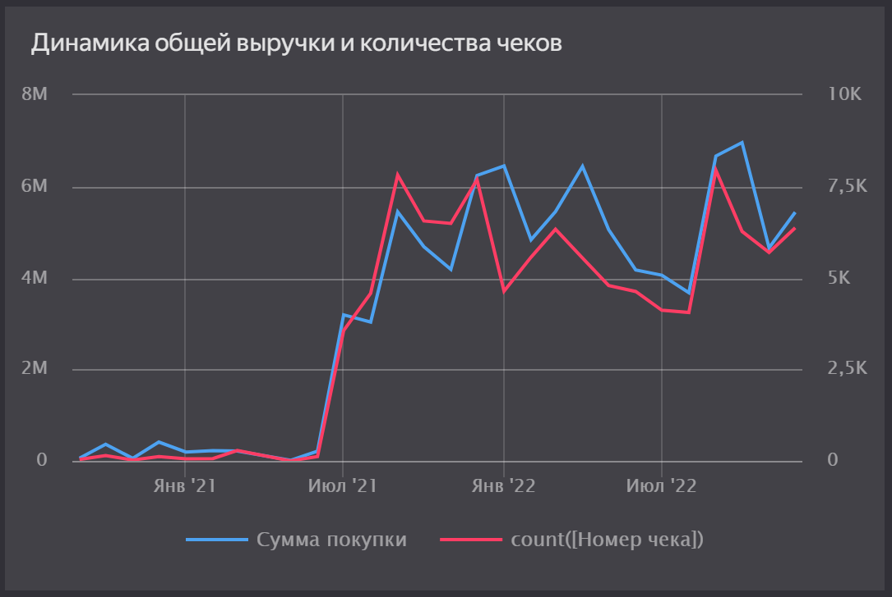
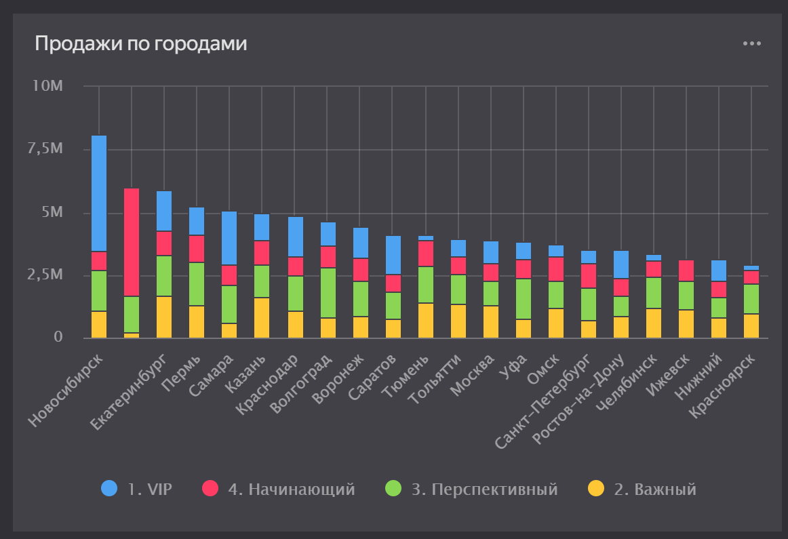
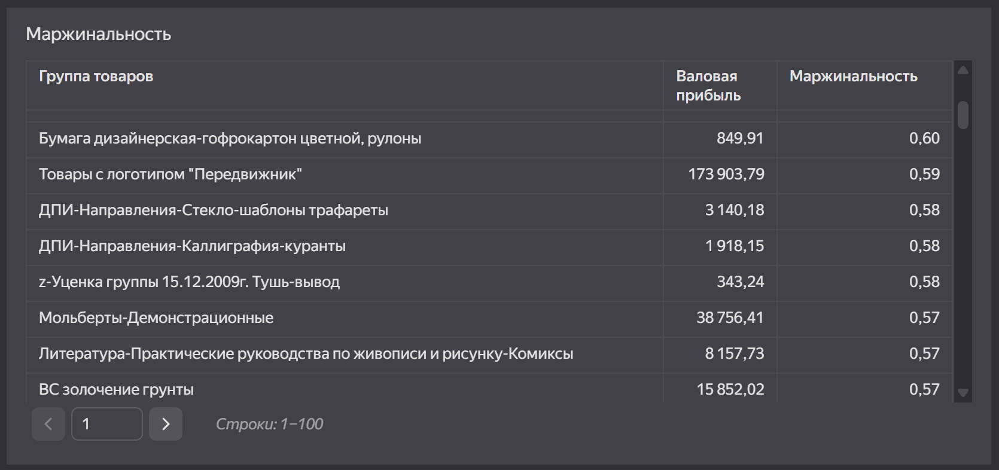

# ETL-обработка данных и визуализация в Yandex DataLens

## 1. Цель проекта
Освоить полный цикл подготовки данных (ETL) в платформе Loginom и построить интерактивный дашборд в Yandex DataLens для анализа розничных продаж.

## 2. Этапы ETL (Extract, Transform, Load)
*   **Extract:** Загрузка данных из трех источников: CSV-файл (продажи), Excel-файл (справочник клиентов) и база данных SQLite.
*   **Transform:** 
    *   Объединение таблиц (Слияние).
    *   Устранение дубликатов.
    *   Обработка выбросов в количестве товаров (метод стандартного отклонения).
    *   Восстановление пропусков в себестоимости через расчет медианной наценки по товарным группам.
    *   Создание новых аналитических признаков (валовая прибыль, ABC-анализ клиентов, бинарный признак «Редкий товар»).
*   **Load:** Выгрузка очищенных данных в CSV.

## 3. Построение дашборда в Yandex DataLens
На основе очищенных данных была построена модель «Снежинка» и созданы следующие визуализации:

### Динамика выручки и количества чеков
Комбинированный график с двумя осями Y, позволяющий отслеживать сезонность продаж.

### География продаж
Столбчатая диаграмма продаж по городам с разбивкой по статусу клиента (VIP, Перспективный, Начинающий).

### Маржинальность и ABC-анализ
Таблицы и графики, показывающие самые прибыльные группы товаров и вклад клиентов в общую выручку.

## 4. Вывод
Разработанный дашборд превращает сырые данные в готовый инструмент для стратегического управления, позволяя принимать обоснованные бизнес-решения на основе актуальной визуализированной информации.
